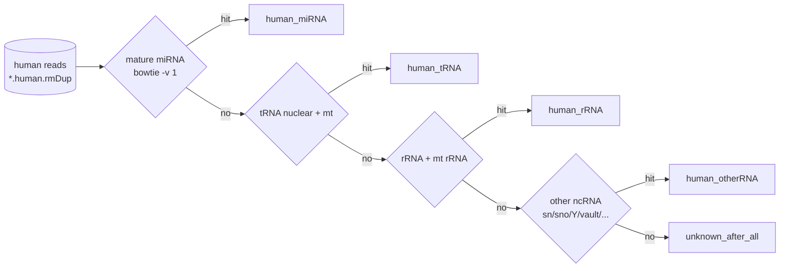
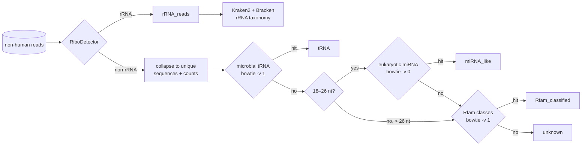

# Classification hierarchies

All small-RNA classifications are **hierarchical and exclusive**: a read (or collapsed sequence) is
assigned to the first class it matches and is not searched further. The order therefore matters: a tRNA
fragment that also matches an Rfam family is counted as tRNA.

## Human reads

| class | reference (`IDX_HSA_*`) | output folder |
| --- | --- | --- |
| `human_miRNA` | mature miRNAs | `human/mirna/` |
| `human_tRNA` | nuclear + mitochondrial tRNAs | `human/trna/` |
| `human_rRNA` | rRNA + mitochondrial rRNA | `human/rrna/` |
| `human_otherRNA` | snRNA, snoRNA, Y RNA, vault RNA and other ncRNAs (`hsa_otherRNA`) | `human/otherrna/` |
| `unknown_after_all` | none of the above (but human genome/transcriptome hit) | `human/otherrna/*.human.unknown.fastq.gz` |

All steps: bowtie 1 `-v 1 -a --best`, fractional counts per reference sequence. The summary
(`summarize_human_subtree.py`) also reports the reads remaining after each step
(`remaining_after_miRNA`, `…_tRNA`, `…_rRNA`).

!!! note "Interpretation"
    Real human small RNA shows a miRNA peak at 21–23 nt and tRNA halves at 30–35 nt. A human fraction
    dominated by `unknown_after_all` and by 18–21-nt reads points to chance hits of microbial reads rather
    than human RNA (see [Read definitions](definitions.md#why-the-length-rules)).

## Non-human reads

| class | method | outputs (`Analysis/<type>/nonhuman/`) |
| --- | --- | --- |
| `rRNA_reads` | RiboDetector (deep-learning rRNA classifier) | `rrna/`; taxonomy in `rrna_tax/` (Kraken2 report, filtered report, Bracken per rank) |
| `tRNA` | bowtie `-v 1 -k 1 --best` on microbial tRNAs | `trna/`: per tRNA, phylum/class, species, amino acid, anticodon, phylum × species |
| `miRNA_like` | 18–26 nt only, exact match (`-v 0`) to eukaryotic mature miRNAs | `mirna_like/` |
| `Rfam_classified` | bowtie `-v 1 -k 1 --best` on Rfam sequences grouped by class | `rfam/`: per class, taxon, class × taxon, family, accession |
| `unknown` | none of the above | `unknown/<sample>.unknown.fa` |

`<sample>.nonhuman.summary.tsv` lists input, rRNA, non-rRNA, collapsed, tRNA, miRNA-like,
Rfam-classified and unknown read counts.

!!! warning "miRNA-like ≠ miRNA"
    Bacteria have no miRNAs. `miRNA_like` only means that an 18–26-nt sequence is identical to a
    eukaryotic miRNA (diet, fungi, host contamination or coincidence) and should be interpreted with care.

## Reads on the sample's contigs

### assembly and bins modules

Both read the assembly BAM (one bowtie mapping, weight 1/NH per alignment). Each alignment gets **one** category, the feature it overlaps best (≥ `BINS_MIN_OVERLAP` of the read):

| category | meaning |
| --- | --- |
| `<type>` (e.g. `CDS`, `tRNA`, `rRNA`) | overlap with a feature of that type on the **same** strand |
| `antisense_<type>` | overlap only on the **opposite** strand |
| `intergenic` | no feature overlap |

Generic features (`gene`, `region`, `source`, `exon`, …) are ignored if a more specific feature overlaps.

### novel module — candidate novel ncRNAs

A **supported cluster** is a strand-specific group of overlapping reads (gap ≤ `NOVEL_MERGEDIST`), 18–250 nt
long, with ≥ 10 reads. It is a candidate

* a candidate only if **no** annotated feature (GFF + ARAGORN tRNA/tmRNA) lies on its own strand, and then
* **intergenic** if no feature lies on either strand,
* **antisense_to_CDS** if it lies opposite a CDS.

## Strandedness

sRNA libraries are stranded: the read has the sequence of the RNA. The pipeline uses this throughout:
database searches only match the forward strand of the references (`DB_NORC=1`, bowtie `--norc`: human
miRNA/tRNA/rRNA/other ncRNA, microbial tRNA, miRNA-like, Rfam), so a read antisense to a tRNA is not called
tRNA; on the contigs every read is sense or antisense to a feature; novel clusters are built per strand and
cmscan only searches the RNA strand of a candidate (`--toponly`). Strand-agnostic steps are the host split
(genome and transcriptome on both strands), RiboDetector and Kraken2 (taxonomy only) and the contaminant
screen.

Candidates with an Rfam hit (`cmscan --cut_ga`) are known ncRNA families; the others
(`candidates.no_rfam.fa`) are folded with RNAfold.

## tRNA and rRNA fragments

Positions are relative to the annotated gene; tolerance `FRAG_TOL` (3 nt); anticodon region =
`FRAG_AC_FROM`–`FRAG_AC_TO` of the tRNA length (0.40–0.55, about nt 30–42 of a 76-nt tRNA).

| tRNA class | 5′ end of the read | 3′ end of the read |
| --- | --- | --- |
| `full_length` | at the tRNA 5′ end | at the tRNA 3′ end |
| `5p_half` | at the 5′ end | in the anticodon region |
| `3p_half` | in the anticodon region | at the 3′ end |
| `5p_tRF` | at the 5′ end | before the anticodon region |
| `3p_tRF` | after the anticodon region | at the 3′ end |
| `i_tRF` | internal | internal |

For fragments ending at the 3′ end, a terminal `CCA` is recorded. rRNA and tmRNA fragments are classed as
`5p_end`, `3p_end`, `full_length` or `internal`, with the fragment midpoint in 10 bins along the gene.
