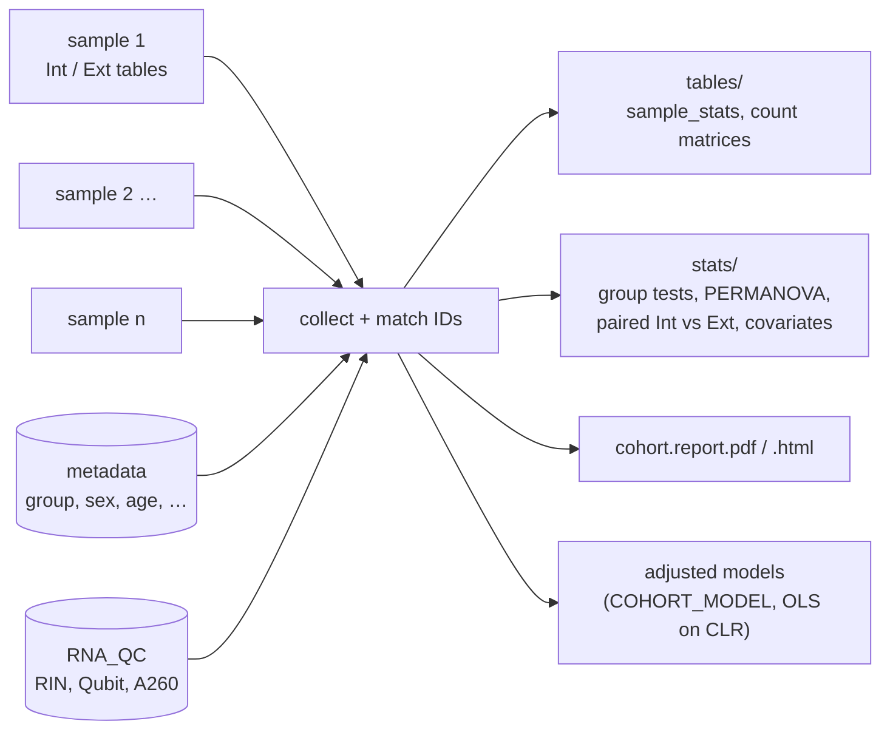

# Cohort analysis

After all samples have run (modules, `--compare`, `--report`), `--cohort` summarises the whole study:
it collects the per-sample tables, joins them with the study metadata (any groups, e.g. healthy controls
and one or more patient groups, and covariates such as sex, age, age at onset, constipation) and writes
tables, exploratory statistics and a cohort report. Group names and the number of groups (≥ 2) are free;
the examples below use `HC` (healthy controls) and two disease groups `PD` and `RA`.

```bash
./srna_pipeline.sh -s samples.tsv -o imp --cohort       # or as part of the SLURM final job
# directly, e.g. with other settings:
python3 scripts/srna_cohort.py --outdir imp --metadata metadata.tsv --group-col group \
        --group-order HC,PD,RA --rna-qc rna_qc.tsv --html
```

The SLURM final job of `submit_srna_pipeline.sh` runs `--compare --report --cohort`; to repeat only that
job: `submit_srna_pipeline.sh -s samples.tsv -o imp --compare-only`.



## Several studies

Each study is one run with its own sample sheet, metadata and output directory, e.g. a second study with
the groups `HC` and `T1D`. Use one config copy per study (or override the settings in the environment):

```bash
COHORT_METADATA=t1d_metadata.tsv COHORT_GROUP_ORDER=HC,T1D \
  ./srna_pipeline.sh -s samples.t1d.tsv -o imp_t1d --cohort
```

With two groups the Kruskal-Wallis test is equivalent to the Mann-Whitney test; everything else is unchanged.

## Metadata

One row per participant (TSV, CSV or XLSX; `metadata.template.tsv` is a template):

| sample_id | group | sex | age | age_at_onset | constipation | BMI | medication |
|---|---|---|---|---|---|---|---|
| BXXX1 | HC | F | 63 | NA | no | 24.1 | none |

- **IDs**: `BXXX1` or `BXXX1.t0F` both match the pipeline sample `BXXX1`; unmatched IDs are listed in
  `tables/cohort.unmatched.txt` (both directions).
- **Missing values**: empty, `NA`, `N/A`, `-`.
- **Column types** are detected: numeric (more than two distinct numbers) or categorical.
  Categorical covariates with more than 12 levels (e.g. free-text medication) are only exported, not tested.
- Settings in `srna_pipeline.config.sh`:

| parameter | default | meaning |
|---|---|---|
| `COHORT_METADATA` | `""` | metadata file; empty = cohort summary without groups |
| `COHORT_ID_COL` | `""` | ID column; empty = first column |
| `COHORT_GROUP_COL` | `group` | group column |
| `COHORT_GROUP_ORDER` | `""` | e.g. `HC,PD,RA` or `HC,T1D`; empty = alphabetical |
| `COHORT_COVARIATES` | `""` | covariate columns; empty = all other columns |
| `COHORT_PERMUTATIONS` | `999` | PERMANOVA permutations |
| `COHORT_MODEL` | `""` | covariate-adjusted models, comma-separated, terms joined by `+`, e.g. `group+site, group+site+sex+age` |
| `COHORT_NMDS` / `COHORT_NMDS_STARTS` | `genus,fn_kegg_pathway,mirna,rfam_family` / `10` | profiles for NMDS pages, random starts |
| `COHORT_TERM_NAMES` | `""` | TSVs term → name for KEGG / Pfam labels |
| `COHORT_MIN_MIRNA_READS` | `50` | minimum human miRNA reads of a library for the miRNA tests |
| `COHORT_SIG_Q` | `0.1` | FDR threshold for bold / key findings |
| `COHORT_OUTLIER_Z` | `4` | robust z above which a library is flagged as outlier (WARN); `0` = off |
| `COHORT_BLOCK` / `COHORT_REFERENCE` | `""` | block column (`site`: nested, `family`: crossed; see [Block designs](#block-designs-site-family)) and reference group (default first group) |
| `COHORT_DIR` | `""` | output directory; empty = `<outdir>/Cohort` |
| `RNA_QC` | `""` | wet-lab RNA QC table (RIN, …), also used by the per-sample report |

## Block designs (site, family)

Many studies have a grouping variable besides the diagnosis that makes samples more alike — a **block**. The
cohort analysis handles it with one setting, `COHORT_BLOCK=<column>`, and decides the design per patient group
from the number of block levels it shares with the reference group (`COHORT_REFERENCE`, default: first group of
`COHORT_GROUP_ORDER`):

| design | shared levels | example | what the block does |
|---|---|---|---|
| **nested** | ≤ 2 | Expobiome `site`: PD only in Kassel, RA only in Berlin, HC in both | confounded with diagnosis; matched controls are needed |
| **crossed** | ≥ 3 | T1D `family`: patients and healthy relatives in the same families | shared environment and genetics; within-family contrasts remove it |

For each group the analysis runs **both** comparisons, so pooled and block-aware results can be read side by side:

| comparison | libraries | test | answers |
|---|---|---|---|
| **pooled** | all libraries of the group vs **all** reference libraries (e.g. all HC of both sites; all T1D vs all HC across families) | Mann-Whitney (exact for n ≤ 20), PERMANOVA | the plain group difference, maximal power |
| **within** | only levels containing both groups (PD vs HC-Kassel; T1D vs HC in the same families) | van Elteren stratified Wilcoxon, PERMANOVA permuted within levels | the difference with the block held constant |
| **block** (nested only) | reference subgroups against each other (HC-Berlin vs HC-Kassel) | Mann-Whitney, PERMANOVA | the size of the site effect alone |

**Poolability check.** The report tests whether the reference group differs between block levels (genus
PERMANOVA; Kruskal-Wallis of the metrics). With too few reference libraries per level — typically one control per
family — it uses all libraries, block after group (partial R²), permuted within groups. Read it like this:

- **no block effect** — pooled comparisons are reasonable (e.g. HC from Kassel and Berlin can be used together),
  and pooled and within results should agree. Small groups have little power: absence of evidence only;
- **block effect** — prefer the within comparisons. In a nested design, patient differences that are not larger
  than the HC-Berlin vs HC-Kassel contrast should not be interpreted as disease effects; PD vs RA cannot be
  separated from site at all. In a crossed design, pooled p-values are too optimistic.

**Models.** In a nested design put the block into the formula (`group+site`; estimable because the controls come
from both sites). In a crossed design each model in `COHORT_MODEL` is fitted twice, e.g. `M1_pooled` (OLS,
SE clustered by family, CR1, t with G − 1 df) and `M1_within-family` (family fixed effects by demeaning, clustered
SE: compares patients with their own relatives).

```bash
# Expobiome (nested)
COHORT_BLOCK=site;   COHORT_REFERENCE=HC; COHORT_MODEL="group+site, group+site+sex+age"
# T1D (crossed)
COHORT_BLOCK=family; COHORT_REFERENCE=HC; COHORT_GROUP_ORDER=HC,T1D; COHORT_MODEL="group+sex+age"
```

Outputs: `stats/cohort.<type>.matched.<comparison>.{metrics,genus,mirna,permanova,rfam_family,fn_<db>}.tsv` per
comparison and a report page *block design and comparisons* per fraction (design table, poolability, all
comparisons). `COHORT_MATCH_COL` is the old name of `COHORT_BLOCK` and still works; any other column (e.g. an
extraction batch) can be used as block.

## Library QC and exclusion

Every library (sample × sRNA type) gets a QC verdict **PASS / WARN / FAIL** from a rules table
(`QC_RULES`, default `scripts/qc_rules.tsv`) plus optional manual decisions (`QC_EXCLUDE`). The same verdict is
shown on the *QC verdict* page of the per-sample report and used by the cohort analysis:

- libraries with **FAIL** are left out of all statistics and of the exported count matrices of their
  fraction (`COHORT_QC_DROP=FAIL`; `WARN` also drops WARN libraries, `none` keeps all). The sample stays in
  with its other fraction, e.g. a sample with a failed sRNA-Ext keeps its sRNA-Int library;
- paired Int vs Ext tests use only samples with both fractions retained;
- missing data (a fraction not sequenced, a missing comparison or RIN) is not an error: such libraries are
  simply absent from the affected analysis, and the numbers of libraries used are reported;
- the *library QC* page shows the verdicts per group, the triggered rules, the excluded libraries and a
  χ² test of exclusion vs group — exclusion that differs between groups can bias comparisons.

Default rules (edit a copy of `scripts/qc_rules.tsv` per study):

| rule | FAIL | WARN |
|---|---|---|
| modules not finished | any missing | – |
| raw reads | < 1 M | < 3 M |
| reads after trimming | < 0.5 M | < 2 M (and < 20 % of raw) |
| adapter dimers | > 50 % | > 20 % |
| non-human reads mapped to own contigs | < 30 % | < 50 % |
| FastQC per-base quality (trimmed) | – | FAIL |
| RIN of the long-RNA fraction (sRNA-Int only) | – | < 5 |
| sRNA vs metaT/metaG comparison | – | missing |

Rules table columns: `rule, metric, op (< <= > >= == !=), threshold, level (WARN/FAIL), types (* or list),
description`. Metrics are the columns of `tables/cohort.sample_stats.tsv`, FastQC modules as
`fastqc_<raw|trimmed>_<module>` (values PASS/WARN/FAIL), `missing_modules` and `missing_compare`.
FastQC's *per base sequence content*, *length distribution*, *duplication* and *overrepresented sequences*
modules are WARN/FAIL for almost every sRNA library by nature and are therefore not rules by default.

In addition, the cohort analysis flags **outliers** within each fraction as WARN: libraries whose value in a key
metric (trimming, adapter dimers, human share, mapping, rRNA / tRNA / unknown shares, tRNA integrity,
sRNA–metaG correlation) lies more than `COHORT_OUTLIER_Z` (default 4) robust standard deviations
(1.4826 × MAD) from the median of the fraction. Fixed thresholds catch failed libraries; the outlier rule catches
libraries that look different from the rest of the study. Outliers stay in the statistics (WARN) — check them
and decide with `QC_EXCLUDE`, or set `COHORT_QC_DROP=WARN`.

Manual decisions (`QC_EXCLUDE`, overriding the rules; `*` = all types of a sample):

```text
sample	type	level	reason
BXXX1	sRNA-Ext	FAIL	library prep problem (lab book)
BXXX7	*	WARN	antibiotics 2 months before sampling
BXXX9	sRNA-Int	PASS	low depth accepted after review
```

## FastQC and MultiQC

The per-sample report shows the FastQC module verdicts of raw and trimmed reads as a grid (*QC verdict*
page). For the full FastQC plots across all samples, `--cohort` also runs **MultiQC** (if `MULTIQC` points
to an installed MultiQC, e.g. from `envs/multiqc.yml`) over all `Stats/` directories (FastQC, cutadapt) and
the per-sample `*_mqc.tsv` tables (read fate, genera, integrity, QC verdict):
`<outdir>/Cohort/multiqc/multiqc_report.html`. Sample names carry the directory (`--dirs`), so sRNA-Int and
sRNA-Ext of a sample stay apart.

## Outputs (`<outdir>/Cohort/`)

| file | content |
|---|---|
| `tables/cohort.sample_stats.tsv` | one row per sample and sRNA type: [read-fate](definitions.md#read-fate) shares, human and miRNA shares, miRNA origin-marker shares, assembly mapping, novel loci, integrity indicators, wet-lab QC, CRISPR, sRNA–metaG/metaT Spearman ρ, metadata |
| `tables/cohort.<type>.<matrix>.counts.tsv` | feature × sample counts of the retained libraries: `mirna`, `genus`, `family`, `species` (Bracken), `rfam_type`, `trna_aa` |
| `tables/cohort.metadata.tsv`, `cohort.unmatched.txt` | metadata of the matched samples with a `qc_<type>` column per fraction (`PASS`, `WARN`, `excluded_FAIL`, `missing`); IDs without data / data without metadata |
| `tables/cohort.qc_flags.tsv` | QC verdict, triggered rules and whether the library entered the statistics |
| `stats/cohort.<type>.metrics_by_group.tsv` | per metric: Kruskal-Wallis H, p, BH q, median per group |
| `stats/cohort.<type>.metrics_pairwise.tsv` | pairwise Mann-Whitney: P(group1 > group2), p, q |
| `stats/cohort.<type>.<matrix>.by_group.tsv` | per feature (≥ 10 reads in ≥ 10 % of samples): Kruskal-Wallis on relative abundance, mean per group |
| `stats/cohort.<type>.<matrix>.permanova.tsv` | Bray-Curtis PERMANOVA for the group and each categorical covariate (marginal) |
| `stats/cohort.paired_Int_Ext.tsv` | paired Wilcoxon sRNA-Int vs sRNA-Ext per metric |
| `stats/cohort.covariates_by_group.tsv` | covariate balance between groups (Kruskal-Wallis / chi-square) |
| `stats/cohort.integrity_vs_qc.tsv` | Spearman of integrity indicators vs wet-lab QC (RIN, …) |
| `cohort.report.pdf` / `.html` | the cohort report (below) |

## Report pages

| page | content |
|---|---|
| overview | libraries per group and fraction (in statistics / all), covariates by group (confounding check; bold p < 0.05) |
| key findings | automatic list of all results below the thresholds (q < `COHORT_SIG_Q` within tables; p < 0.05 for PERMANOVA, covariates, exclusion) |
| library QC | QC verdicts per group, triggered rules, exclusion vs group |
| flagged libraries | every WARN / FAIL library with group, site, reasons and whether it is in the statistics |
| library metrics | read-fate shares (trimming, human, rRNA / tRNA / Rfam / unknown), adapter dimers, mapping, depth, novel loci, CRISPR |
| RNA integrity | integrity indicators and RIN per group |
| integrity vs RIN | scatter plots and strongest associations of indicators with wet-lab QC |
| RNA integrity summary | per indicator: medians per fraction, Int vs Ext, group test per fraction, ρ with RIN, and the significant results in words |
| genera | mean genus composition per group and fraction |
| NMDS | non-metric multidimensional scaling of Bray-Curtis dissimilarities per profile (`COHORT_NMDS`: genera, KEGG pathways, Int miRNAs, Rfam families), Int and Ext side by side, 95 % group ellipses, shapes by site, stress and PERMANOVA |
| beta diversity | Bray-Curtis PCoA per fraction, PERMANOVA table |
| human miRNAs | miRNA share and depth, origin-marker shares (samples with ≥ 20 miRNA reads) |
| RNA classes | composition of every library by RNA class (rRNA, tRNA, miRNA-like, snoRNA, snRNA, sRNA, riboswitch, leader, ribozyme, intron, tmRNA, SRP, 6S, RNase P, …) — all classes and without rRNA/tRNA/unknown; group tests per class and per Rfam family (page 2) |
| functional categories | sRNA reads on CDS (sense) per KEGG pathway / module / KO, Pfam and COG: top pathways per group, tests per database, block comparisons |
| antisense transcription | antisense share on CDS, strand error (antisense on rRNA/tRNA genes), antisense hotspots per KEGG pathway / KO / Pfam, antisense index between groups and per block comparison |
| top human miRNAs | the 12 most abundant miRNAs per group (share of miRNA reads; libraries with ≥ `COHORT_MIN_MIRNA_READS`), Kruskal-Wallis p with stars, FDR-significant ones in red; a note page when a fraction has too few miRNA reads |
| block design and comparisons | design per group, poolability of the reference, pooled / within / block comparisons (with `COHORT_BLOCK`) |
| Int vs Ext | paired comparison of the two fractions |
| sRNA vs omics | per-sample sRNA–metaG / metaT correlations per group |
| group differences | top metrics, genera and miRNAs per fraction (exploratory) |
| methods | tests, filters, caveats |

**Significance marks.** Box plots show the Kruskal-Wallis p per fraction (`*` < 0.05, `**` < 0.01, `***` < 0.001);
the label turns bold red when the FDR q of that test (within the table of the fraction) is below `COHORT_SIG_Q`
(default 0.1). Table rows below the threshold are bold on a yellow background.

## RNA classes and functional categories

**RNA classes** are built per library from the classification: rRNA (RiboDetector + Rfam rRNA hits), tRNA
(tRNA database + Rfam tRNA), miRNA-like, unknown, and the remaining Rfam hits split by their Rfam type
(snoRNA, snRNA, sRNA, riboswitch, leader, other cis-regulatory, ribozyme, intron, antisense, lncRNA, CRISPR,
antitoxin) — house-keeping RNAs of type *Gene* are named by their family (tmRNA, SRP RNA, 6S RNA, RNase P).
Shares (`class_*` in `cohort.sample_stats.tsv`) are tested between groups, in the block comparisons and
**within samples between sRNA-Int and sRNA-Ext** (paired page). Rfam families other than rRNA/tRNA are tested as
shares of the other Rfam reads (`rfam_family` matrix).

**Functional categories** use the sRNA reads on protein-coding genes of the assembly module (`functions.tsv`):
KEGG pathways (global maps ko011xx/ko012xx left out), modules, KOs, Pfam domains and COGs, sense reads as
shares within each database. Sense reads on CDS are mostly mRNA fragments, so these profiles describe which
genes are transcribed and turned over, not regulatory RNAs; antisense counts are exported
(`fnas_<db>` matrices) but not tested. Readable names need `COHORT_TERM_NAMES` (e.g. KEGG REST `list/ko`,
`list/pathway`, `list/module` saved as TSV, or `Pfam-A.clans.tsv`).

| file | content |
|---|---|
| `tables/cohort.<type>.rna_class.counts.tsv`, `….rfam_family.counts.tsv` | reads per RNA class / Rfam family |
| `tables/cohort.<type>.fn_<db>.counts.tsv`, `….fnas_<db>.counts.tsv` | sense / antisense reads per functional term |
| `stats/cohort.<type>.{rna_class,rfam_family,fn_<db>}.by_group.tsv` | group tests (with term names if given) |
| `stats/cohort.<type>.fn_kegg_{pathway,ko}.permanova.tsv` | PERMANOVA of functional profiles |
| `stats/cohort.<type>.matched.<comparison>.{rfam_family,fn_<db>}.tsv` | block comparisons |

## Antisense transcription

Reads antisense to protein-coding genes are a large part of the sRNA reads on CDS. They can be antisense RNAs
(base-pairing regulators of the mRNA), transcripts of overlapping genes on the opposite strand, or strand
errors of the library. The **strand error** is measured on rRNA and tRNA genes, where antisense reads are
artefacts; it is typically ~0.01–0.1 %, far below the CDS antisense share.

| measure | meaning |
|---|---|
| `antisense_CDS_fraction` | antisense / (sense + antisense) reads on CDS per library (groups, block-matched, Int vs Ext) |
| `antisense_strand_error` | the same on rRNA/tRNA genes |
| `antisense_CDS_enrichment_log2` | log2 of the ratio of the two |
| antisense index | AS / (sense + AS) per functional term and library (≥ 10 reads): `tables/cohort.<type>.antisense_index.<db>.tsv` |
| hotspots | terms whose index is consistently above (or below) the library's CDS average: median log2 ratio, fraction of libraries above, one-sample Wilcoxon, BH-FDR: `stats/cohort.<type>.antisense_hotspots.<db>.tsv` |
| group tests | antisense index between groups (Kruskal-Wallis) and per block comparison (Mann-Whitney / van Elteren): `….antisense_index.<db>.by_group.tsv`, `….matched.<comparison>.antisense_index.<db>.tsv` |

!!! warning "rRNA reads and spurious ORFs"
    Reads that are sense to an **unannotated** (partial) rRNA — e.g. the start of a 23S gene at the end of a short
    contig — are antisense to ORFs that gene prediction places on the opposite strand of the rRNA. In a test
    library ten such "hypothetical proteins" carried 70 % of all CDS-antisense reads. The assembly module
    therefore also counts every gene and function **without rRNA reads** (`*_non_rRNA` columns of
    `feature_counts.tsv`, `functions.tsv`, `category_counts.tsv`), and the cohort analysis uses these counts.
    rRNA reads are the RiboDetector rRNA reads **plus** reads with an Rfam rRNA hit (matched by sequence,
    `RRNA_EXCLUDE_RFAM=1`): RiboDetector misses many short fragments — in BXXX1 sRNA-Int 2.4 M of 5.9 M rRNA reads,
    mostly bacterial LSU — so the RiboDetector filter alone removed hardly any of the artefact. Libraries
    processed before this change are marked on the antisense page — rerun
    `ASSEMBLY_RECOUNT_ONLY=1 srna_pipeline.sh -m assembly,novel -f` (the Rfam list is built from the existing
    hits file; no remapping). Sample-specific rRNA variants that neither filter recognises are handled by the
    **rRNA rescue** of module novel (cmscan on contigs with antisense-only genes; the hits become rRNA genes and the
    counts are redone) — in BXXX1 sRNA-Int one unannotated 23S gene carried 59 % of the remaining CDS-antisense reads.

The index is independent of how strongly a gene is expressed, so group differences are not simply
expression changes. Overlapping genes on the opposite strand can create apparent hotspots — check
candidate loci in the per-gene table of the assembly module (`<s>.feature_counts.tsv`, sense / antisense
reads per gene).

## NMDS

Non-metric multidimensional scaling (Kruskal) places the libraries in two dimensions so that the **rank order**
of their Bray-Curtis dissimilarities is preserved as well as possible (SMACOF with monotone regression, best of
`COHORT_NMDS_STARTS` random starts plus a PCoA start; implemented in numpy and checked against scikit-learn). Unlike
PCoA, it makes no assumption about the scale of the dissimilarities. **Stress** (Kruskal stress-1) is the misfit:
< 0.1 good, 0.1–0.2 fair, > 0.2 poor — then the 2-D picture should not be over-interpreted. NMDS axes have no units
and no explained variance; whether the groups differ is tested by the PERMANOVA shown on the plot (same
Bray-Curtis matrix). Coordinates: `stats/cohort.<type>.<profile>.nmds.tsv`.

## Interpretation and caveats

!!! warning "Exploratory statistics"
    The group tests are unadjusted (no covariates), treat relative abundances as independent features and
    are corrected for multiple testing only within each table. They point to candidates — group
    differences should be confirmed with the covariate-adjusted models (`COHORT_MODEL`).

- **Confounders.** Disease-associated factors change stool, microbiome and possibly RNA integrity by
  themselves — e.g. constipation and slower transit (frequent in Parkinson's disease), medication
  (e.g. levodopa, immunosuppressants, insulin), diet, age and sex. Check the covariate table on the overview
  page first and include such covariates in adjusted models.
- **Related or repeated samples.** Family members (e.g. in family-based designs) or several time points of
  one person are not independent; the tests here assume independent samples. Give repeated samples distinct
  sample IDs and model family / person as a random effect downstream.
- **Technical covariates.** Sequencing depth, integrity indicators / RIN and extraction batch can differ
  between groups and should enter models as covariates.
- **Human miRNAs** are few (often hundreds of reads per sample): group comparisons of single miRNAs have
  low power; marker-set shares are more robust.
- **PERMANOVA** is also significant when groups differ in dispersion, not only in location.
- **Int and Ext** of the same sample are not independent: analyse them separately or with the sample as a
  random effect.

## Adjusted models

With `COHORT_MODEL` the cohort analysis fits covariate-adjusted linear models in Python (numpy, no R),
the model type MaAsLin2 uses by default:

```bash
COHORT_MODEL="group+site, group+site+sex+age, group+site+sex+age+constipation_status"
```

A model can be restricted to some samples with `| column=value1/value2`, e.g.
`levodopa+bristol+laxative+sex+age | group=PD` (PD only). The **term of interest** of a model — reported in the
summary, the volcano plots and the key findings — is the **first term** of the formula (put `group` first for
group comparisons) (e.g. `bristol+laxative+group+site+sex+age` reports the stool-consistency effect adjusted for group).
Yes/no and normal/abnormal variables use "no" / "normal" as reference level.

Several models are separated by commas (terms by `+`) and numbered M1, M2, … in the report, the key findings
and the file names; `stats/cohort.models.tsv` lists the models with the number of libraries per fraction. Fitting
a minimal model and adding covariates step by step shows whether a group difference is robust to them.

- **Outcomes**: every genus, family, miRNA (fractions with enough miRNA reads), Rfam family, RNA class, KEGG
  pathway / module / KO, Pfam domain and COG — as **CLR**-transformed abundances (pseudocount 0.5; features with
  ≥ 10 reads in ≥ 10 % of the libraries) — plus all library metrics (integrity, class shares, antisense share,
  …) and the **antisense index** per KEGG pathway and KO.
- **Terms**: metadata columns or library metrics (e.g. `qc_lRNA_RIN`, `integrity_tRNA_3p_CCA_fraction`) as
  technical covariates. Categorical terms become treatment contrasts (group reference: `COHORT_REFERENCE` or the
  first group), numeric terms are scaled to SD units. Complete cases only.
- **Minimum data per fit**: a feature is modelled only with ≥ 20 libraries (≥ 40 for the antisense index, which
  only counts libraries with ≥ 10 reads on the term; and ≥ 3 × the number of terms),
  ≥ 3 libraries in and outside every group / site level, ≥ 5 distinct outcome values and no library with leverage
  > 0.95 — otherwise single libraries carry a contrast and the robust SE collapses (spurious q ≪ 0.001).
- **Estimation**: OLS with HC3 heteroscedasticity-robust standard errors, t-test, BH-FDR per term within each
  outcome set. Terms that are fully confounded with others are dropped and reported (in the Expobiome design,
  `group + site` is estimable because the controls come from both sites).
- **Output**: `stats/cohort.<type>.model_<M>.<set>.tsv` (feature, n, term, estimate, SE, t, p, q for every term),
  `stats/cohort.<type>.model_<M>.design.tsv` (the design matrix); a summary page and volcano plots per group
  contrast (genera, KEGG pathways, KO antisense index); significant group contrasts in the key findings; an
  overview page compares the term of interest of all models side by side.
- **Estimates**: for CLR outcomes, the difference in log abundance relative to the sample's mean feature
  (≈ log fold change), adjusted for all other terms.

Families are handled with `COHORT_BLOCK=family` (clustered SE and within-family variants, see
[Block designs](#block-designs-site-family)); random-effect models are not fitted. Several visits per person: use one
sample per person, or the person as block.
