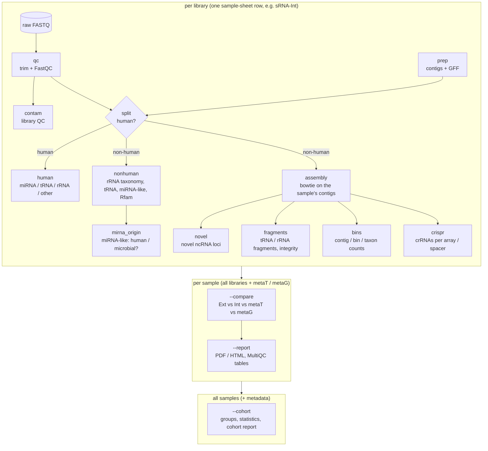

# sRNA-IMP pipeline

sRNA-IMP analyses small-RNA sequencing data of microbiome samples. It takes **one raw
single-end small-RNA FASTQ per sample** and **sRNA type**, removes adapters and low-quality bases, separates
**human** from **microbial (non-human)** reads, and classifies both against curated small-RNA databases and against the [IMP3](https://genomeanalysislcsb.github.io/IMP3/) **multi-omic metagenomic assembly** (contigs, annotation, bins) from the same sample.

The pipeline works on three levels: modules per sample-sheet row (one sRNA library), steps per sample
(all its libraries together with metaT / metaG) and a cohort summary over all samples.



## sRNA types

Each sample can have multiple small-RNA libraries (intracellular, extracellular); every library is one row of the sample sheet and is
processed into its own sub-tree `<sample>/Analysis/<type>/`:

| type | material |
| --- | --- |
| `sRNA-Int` | intracellular small RNA (microbial cell fraction of the stool sample) |
| `sRNA-Ext` | extracellular small RNA (cell-free fraction) |
| any other name | processed identically, e.g. `sRNA-Ext-Int` |

## Files

| file | purpose |
| --- | --- |
| `srna_pipeline.sh` | the pipeline: all modules per row, `--compare` / `--report` per sample, `--cohort` |
| `srna_pipeline.config.sh` | all paths, environments and parameters |
| `submit_srna_pipeline.sh` | SLURM submission: one array task per sample-sheet row + one final job (compare, report, cohort) |
| `srna_make_samples.sh` | builds the sample sheet of a whole study from a template and an ID list |
| `srna_status.sh` | status of a run per row (done / running / failed) and resubmission of failed rows |
| `srna_pack_summary.sh` | packs the summary tables, logs and reports for a quick check |
| `samples.example.tsv`, `metadata.template.tsv` | sample sheet and cohort metadata templates |
| `scripts/` | Python helper scripts (copy to `SCRIPTS_DIR`) |

## Quick start

```bash
./srna_pipeline.sh -s samples.tsv -o /path/to/imp --check-env    # environments, tools, databases
./srna_pipeline.sh -s samples.tsv -o /path/to/imp --check        # + all inputs of the sample sheet
./submit_srna_pipeline.sh -s samples.tsv -o /path/to/imp -n 16 --mem 64G
./srna_status.sh -s samples.tsv -o /path/to/imp                  # progress; --resubmit for failed rows
```

See [Cohort analysis](cohort.md) for the summary over all samples with the study metadata.

!!! tip "Most important definitions"
    What the pipeline calls a *human* read, a *non-human* read or an *unknown* read is defined precisely
    in [Read definitions](definitions.md). Read this page before interpreting any numbers.

## Related tools

| tool | role |
|---|---|
| [IMP3](https://genomeanalysislcsb.github.io/IMP3/) ([GitHub](https://github.com/genomeanalysislcsb/IMP3)) | metagenomic + metatranscriptomic pipeline; provides the assembly, annotation, bins and metaT / metaG counts that sRNA-IMP uses |
| [IMP explorer](https://genomeanalysislcsb.github.io/imp-explorer/) ([GitHub](https://github.com/genomeanalysislcsb/imp-explorer)) | study-level interactive exploration of IMP3 results (QC, taxonomy, MAGs, functions); sRNA results can be added as a study layer |

## Building this documentation

```bash
pip install -r docs/requirements.txt
mkdocs serve          # preview at http://127.0.0.1:8000
mkdocs build          # static site in site/
```

On [Read the Docs](https://readthedocs.org) import the repository; `.readthedocs.yaml` configures the build.
