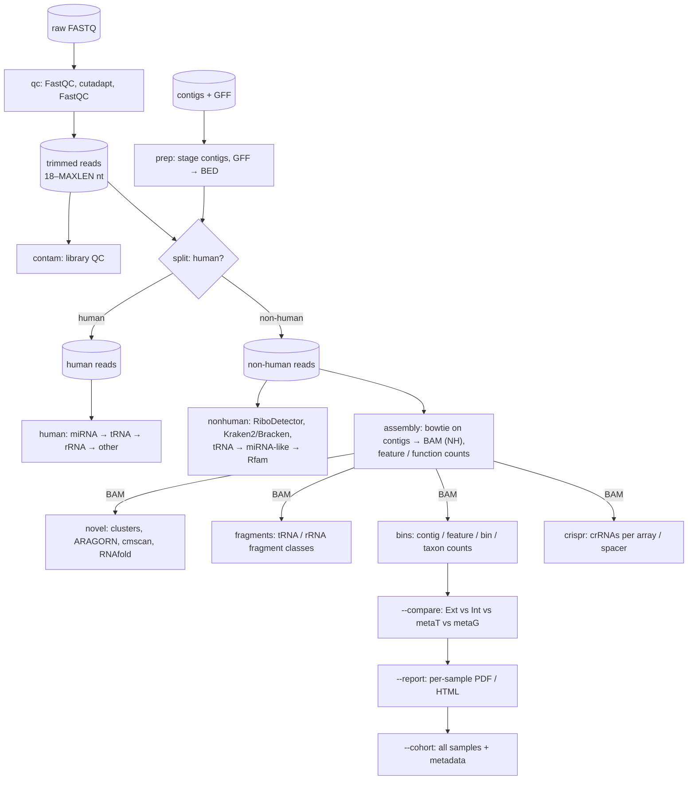

# Overview of the steps

Modules run per sample-sheet row, always in this order (whatever order `-m` lists them in):

`qc → contam → prep → split → human → nonhuman → assembly → novel → fragments → bins → crispr`, and per sample
afterwards `--compare`.

A finished module writes `log_cluster_jobs/<type>/.<module>.done` and is skipped on re-runs unless `-f`
is given. Tool logs go to `log_cluster_jobs/<type>/<module>/`.

---

## 1. qc — trimming and FastQC

| step | tool | parameters (config) |
| --- | --- | --- |
| stage raw reads | `cp` / `ln -s` | `STAGE_MODE` |
| FastQC on raw reads | FastQC | `-t THREADS` |
| adapter + quality + length trimming | cutadapt | `-a ADAPTER_3P [-a ADAPTER_3P[ADAPTER_3P_TRUNC:]] -q TRIM_QUALITY -m MINLEN -M MAXLEN CUTADAPT_EXTRA` |
| FastQC on trimmed reads | FastQC | |

Defaults: `ADAPTER_3P=AGATCGGAAGAGCACACGTCTGAACTCCAGTCAC`, `TRIM_QUALITY=15`, `MINLEN=18`, `MAXLEN=50`
(use the read length, e.g. 100 for 52-nt reads, to keep reads without adapter), `CUTADAPT_EXTRA` e.g.
`--poly-a --trim-n`.

The second adapter is the 3′ adapter without its first `ADAPTER_3P_TRUNC` (10) bases. A regular 3′
adapter is only recognised from its first base, so dimers whose read starts *inside* the adapter
(observed: `GGAAGAGCACACG…` + index + P7, the NEBNext index primer, 0.38 % of one library) passed
trimming unchanged. With the suffix adapter they are cut to ≤ 10 nt and removed by `-m`; normal reads
still match the full adapter (cutadapt keeps the match with most matching bases). The QC
`adapter_dimers_raw` metric counts both forms.

## 2. contam — library QC (`srna_pipeline.sh`)

Writes `Stats/<type>/<sample>.<type>.qc_summary.tsv` with

* adapter dimers in the raw reads (read starts with the first 12 nt of the adapter),
* the cutadapt outcome (with adapter, too short, too long, passing),
* library complexity: distinct and singleton sequences, share of the 10 most frequent sequences,
* one line per contaminant FASTA in `CONTAM_FA` (bowtie `-v CONTAM_MISMATCHES -k 1`),

plus the `QC_TOP_SEQS` most frequent sequences (`*.overrepresented.tsv`) and per-target contaminant hits.

## 3. prep — contigs and annotation

Copies the contigs to `Assembly/<sample>.mgmt.assembly.merged.fa.gz`, the GFF to
`Analysis/annotation/<sample>.gff` (strand `?` → `.`) and converts it to `<sample>.bed` (`gff2bed`).
Shared by all types of a sample and protected by a lock.

## 4. split — human vs non-human

The trimmed reads are split into **human** and **non-human** reads. The exact rule is given in
[Read definitions](definitions.md#human-read); in short:

1. reads shorter than `HOST_MIN_LEN` (20 nt) are never human;
2. bowtie 1 end-to-end against the human genome, `-k 1 --best`, `-v HOST_SHORT_MISMATCHES` (0) for reads
   < `HOST_SHORT_LEN` (22 nt), `-v HOST_MISMATCHES` (default 0, i.e. exact matches at every length) for
   longer reads;
3. genome-unmapped reads are mapped the same way against the human transcriptome (exon junctions);
4. **assembly check**: every human hit is mapped to the sample's own contigs; a read that matches a contig
   with no more mismatches than the human reference is moved back to non-human;
5. human reads are de-duplicated by name (`seqkit rmdup`) → `*.human.rmDup.fastq.gz`.

Outputs: `Preprocessing/<type>/<sample>.human.fastq.gz`, `.human.rmDup.fastq.gz`, `.nonhuman.fastq.gz`,
`Stats/<type>/<sample>.<type>.read_stats.tsv`, `.human_length_dist.tsv`, `.seqkit.txt`.

## 5. human — human small-RNA classes

Sequential bowtie 1 search (`-v 1 -a --best`) of the human reads; reads not matched at one level go to the
next (details in [Classification](classification.md#human-reads)):

`miRNA → tRNA → rRNA → other ncRNA → unknown`

Counts per sequence feature are fractional (`sam_fractional_counts.py`: a read with n best hits adds 1/n
to each). `summarize_human_subtree.py` writes the summary table per class.

## 6. nonhuman — microbial small-RNA classes

1. **rRNA filter**: RiboDetector (`--len` = mean read length) splits rRNA / non-rRNA reads. Short rRNA fragments
   are often missed and end up in the Rfam class screen (step 7) as rRNA; their sequences are written to
   `rfam/<s>.rfam_rRNA.seqs.gz` and excluded, together with the RiboDetector reads, from the antisense counts
   and the novel loci.
2. **rRNA taxonomy**: Kraken2 (`--confidence KRAKEN_CONF`, `--minimum-hit-groups KRAKEN_MINHITGROUPS`,
   `--report-minimizer-data`, `--memory-mapping`) on the rRNA reads; report filtered to taxa with
   ≥ `KRAKEN_REPORT_MINREADS` clade reads and (species) ≥ `KRAKEN_MIN_DISTINCT_MINIMIZERS` distinct minimizers; Bracken (`-r 50 -t BRACKEN_MIN_READS`) on the filtered report
   at the ranks `K P C O F G S`.
3. non-rRNA reads are **collapsed** to unique sequences with counts.
4. **tRNA**: bowtie `-v 1 -k 1 --fullref` against microbial tRNAs → counts per tRNA, phylum/class, species, amino
   acid, anticodon.
5. tRNA-unmatched sequences of 18–26 nt (`MIRNA_LIKE_*`) → **miRNA-like**: exact match (`-v 0`) to
   eukaryotic miRNAs.
6. everything left (miRNA-unmatched 18–26 nt + all > 26 nt) → **Rfam classes**: bowtie `-v 1 -k 1 --fullref` (the full reference header, with spaces, is needed to parse class, family and taxon);
   counts per class, taxon, family and accession.
7. remaining sequences = **unknown** (`nonhuman/unknown/<sample>.unknown.fa`).

## 7. assembly — mapping on the sample's contigs

The **one** mapping of the non-human reads to the contigs; its BAM is used by `novel`, `fragments`,
`bins` and `--compare`.

1. uncollapsed non-human reads → bowtie `-v ASSEMBLY_MISMATCHES --best --strata` and at most
   `ASSEMBLY_MAX_HITS` (50) equally good hits (`-k`; 0 = all hits, `-a`) on the contigs (bowtie index of the
   contigs, built once and shared with the host-split rescue);
2. the number of hits of each read is added as `NH:i:<n>`; sorted, indexed BAM
   `Analysis/<type>/assembly/<sample>.bam` (unmapped reads included);
3. `srna_bins.py`: every alignment counts 1/NH and is assigned to the feature it overlaps best on the
   **same strand** (sense); if there is none, to a feature on the opposite strand (`antisense_<type>`);
   otherwise `intergenic`. Outputs: feature counts (with gene and product), categories, contigs, functional
   terms of the CDS (`functions.tsv`: COG, KEGG KO/pathway/module/BRITE, EC, GO, Pfam, TIGRFAM, eggNOG;
   every term of a gene gets the gene's reads), read lengths of mapped and unmapped reads;
4. `mapping_summary.tsv`: input, mapped, unmapped reads, alignments.

## 8. novel — novel ncRNA loci

Reads that RiboDetector classified as rRNA (module nonhuman), and reads with an Rfam rRNA hit
(by sequence, `RRNA_EXCLUDE_RFAM=1`; RiboDetector misses many short fragments), are left out before clustering
(`NOVEL_EXCLUDE_RRNA=1`): otherwise they form candidate loci on unannotated or partial rRNA genes at contig
ends — about a third of all candidates in a test library — which cost cmscan time and are not novel.
tRNA / tmRNA loci are already excluded by the annotation and ARAGORN.

**rRNA rescue** (`RRNA_RESCUE=1`, first step of the module, needs cmscan). Read-based filters do not catch all
rRNA reads: in BXXX1 one unannotated 23S gene behind a 16S–tRNA-Ala–tRNA-Ile operon fragment carried 59 % of all
remaining CDS-antisense reads, on a "hypothetical protein" predicted on the other strand. The module therefore takes
the CDS with ≥ `RRNA_RESCUE_MIN_ANTISENSE` (20) antisense reads and sense ≤ `RRNA_RESCUE_MAX_SENSE_RATIO` (0.1) ×
antisense from `assembly/<s>.feature_counts.tsv`, searches their contigs with cmscan against the Rfam rRNA models only
(5S, 5.8S, SSU, LSU; extracted once from `RFAM_CM` into `RRNA_RESCUE_CM`, default `<outdir>/.shared/Rfam.rRNA.cm`),
writes the hits that do not overlap an annotated rRNA to `assembly/<s>.rRNA_rescue.bed` (type `rRNA`, product with
the Rfam family, score and E-value) and **recounts the assembly mapping** with them (`feature_counts`,
`category_counts`, `functions`, … are rewritten; the log shows antisense_CDS before → after). The rescued genes are
used by all later steps of the type — novel-loci annotation, `fragments` (rRNA fragments and integrity), `bins`,
and re-runs of `assembly`. CDS on the opposite strand of a rescued gene (overlap ≥ 50 % of the shorter one) are
**flagged** (`flag = opposite_rescued_rRNA` in `feature_counts.tsv`): they are left out of `functions.tsv`, the
top-gene tables of the report and the feature comparisons with metaT / metaG (their metaT reads are most likely
residual rRNA as well). The original GFF is **not** changed; `Analysis/annotation/<s>.rRNA_rescued.gff` is the GFF3
with the rescued genes of all types (source `cmscan`) and `note=opposite_rescued_rRNA` on the flagged CDS — for
genome browsers or to feed back upstream. For older runs: `-m novel,fragments,bins -f` and `--compare --report`
(no remapping).

1. alignments from the assembly BAM (weight 1/NH);
2. reads merged per strand into clusters (`bedtools merge -d NOVEL_MERGEDIST`);
3. clusters kept with length `NOVEL_MINLEN`–`NOVEL_MAXLEN` (18–250 nt) and ≥ `NOVEL_MINREADS` (10) reads.
   Read support is weighted: each alignment of a read with *n* equally good hits counts 1/*n*, so
   repeated loci (rRNA operons, multi-copy tRNAs) are not inflated. Candidate BEDs: column 7 = weighted
   reads, column 8 = alignments;
4. annotation = GFF features + ARAGORN tRNA/tmRNA (+ tRNAscan-SE if `RUN_TRNASCAN=1`);
5. candidates (reads are stranded): only clusters with **no feature on their own strand**; of these
   **intergenic** = no feature on either strand, **antisense to CDS** = opposite a CDS;
6. candidates with an Rfam hit (`cmscan CMSCAN_OPTS`, default `--rfam --cut_ga --toponly`: only the RNA strand of the candidate; truncated hits are allowed since candidates are fragments of longer RNAs) are separated; the rest are folded (`RNAfold`).

## 9. fragments — tRNA / rRNA fragment analysis (`srna_pipeline.sh`)

Every alignment of the novel BAM overlapping a tRNA, rRNA or tmRNA (`FRAG_TYPES`) on the same strand by
≥ `FRAG_MIN_OVERLAP` of its length is classified by its position on the parent RNA (multi-mappers 1/n);
see [Classification](classification.md#trna-and-rrna-fragments). Features with ≥ `FRAG_MIN_READS` reads
get per-position 5′-end, 3′-end and coverage profiles (cleavage sites).

**RNA integrity** (`scripts/srna_integrity.py`, run at the end of the module). A RIN-like 5′→3′ coverage skew
does not apply to size-selected sRNA libraries, so integrity is read from how *defined* the fragment ends are.
Processed RNAs (mature tRNAs, tRNA halves, crRNAs) have sharp ends; random chemical or nuclease degradation gives
diffuse ends and an even spread of fragments along long RNAs. Indicators in `<s>.integrity.tsv`:

| indicator | meaning |
|---|---|
| `reads_le20nt_fraction`, `reads_ge30nt_fraction`, `median_read_length` | read length profile of all reads entering the assembly mapping |
| `tRNA_mature_end_fraction` / `tRNA_internal_fraction` | tRNA reads with ≥ 1 end at the mature 5′/3′ end vs. internal fragments (i-tRFs; ↑ degraded) |
| `tRNA_3p_CCA_fraction` | 3′-anchored tRNA reads carrying the terminal CCA (↑ intact) |
| `tRNA_halves_fraction` | anticodon cleavage — a stress response, **not** a degradation measure |
| `tRNA/rRNA_5p_end_entropy`, `*_top3_share` | normalised entropy of end positions per feature (≥ 50 tRNA / ≥ 200 rRNA reads) and share of the three main end positions (needs `fragments.ends.tsv`) |
| `rRNA_bin_evenness` | evenness (0–1) of fragment midpoints over 10 bins along complete 16S/23S genes (↑ random cuts) |
| `rRNA_16S/23S_5p_3p_log2ratio` | reads in the 5′ vs. the 3′ 30 % of complete genes |

`<s>.integrity.profile.tsv` has the 10-bin profiles, `<s>.integrity.features.tsv` the per-feature end statistics.
The indicators are relative: compare samples **within one fraction** (cell-free sRNA-Ext is expected to differ
from sRNA-Int for biological reasons) and, where available, against RIN/DV200 of the same extractions.

## 10. bins — counts per contig, feature, bin and taxon (`srna_pipeline.sh`)

Each alignment is assigned to the feature it overlaps best (≥ `BINS_MIN_OVERLAP`): same strand →
`<type>`, opposite strand only → `antisense_<type>`, nothing → `intergenic`. Counts are summed per contig,
feature, category, bin (from `contig2bin`, with GTDB-Tk taxonomy, completeness, contamination and
quality class HQ/MQ/LQ) and GTDB rank. In `--compare`, the bin tables carry the same columns and the
summary adds a correlation over HQ + MQ bins only.

## 10b. crispr — small RNAs on CRISPR arrays (`srna_pipeline.sh`)

CRISPR arrays (Bakta `CRISPR` with `crispr-repeat` / `crispr-spacer` units; arrays carry no strand) are
transcribed into a pre-crRNA that is processed into mature **crRNAs** (spacer + part of a repeat). Highly
expressed arrays therefore show up as sRNA peaks on single spacers, as in metatranscriptomic examples.
`scripts/srna_crispr.py` reads the assembly BAM (weight 1/NH) and for every array

* counts all reads on the array (≥ 50 % of the read inside), reads per kb, and infers the **transcribed
  strand** from the read strands (`strand_fraction` = share of the majority strand);
* assigns each read on the transcribed strand to the **spacer** it overlaps by ≥ 10 nt (largest overlap),
  otherwise to the repeat it overlaps most; units are listed in transcription order;
* records the 5′ and 3′ read ends relative to the spacer (`crispr_ends.tsv`): e.g. type II crRNAs start
  inside the spacer and end ~20 nt into the following repeat;
* finds Cas genes within 10 kb on the same contig and assigns the **CRISPR-Cas type** (cas9/csn2 → II,
  cas3 → I, cas10/csm/cmr → III, cas12 → V, cas13 → VI; only cas1/cas2 → "adaptation only"), with the reads
  on the cas genes from the assembly feature counts;
* adds bin and GTDB taxonomy (`contig2bin`, `gtdbtk` columns of the sample sheet).

Outputs (`Analysis/<type>/crispr/`): `<s>.crispr_arrays.tsv`, `<s>.crispr_units.tsv` (spacer sequences
included, e.g. to search protospacers), `<s>.crispr_ends.tsv`, `<s>.crispr_lengths.tsv`, `<s>.crispr_genes.tsv` (Cas genes) and
`<s>.crispr_coverage.tsv` (per-base + / − coverage of the 5 arrays with most reads, with their Cas genes and
500 nt flanks; run-length encoded) for the locus plots of the report.

## 11. --compare — sRNA-Ext vs sRNA-Int vs metaT vs metaG (`srna_pipeline.sh`)

Per sample, every available pair of sources is compared **on its own**, in its own folder
`Analysis/comparison/<A>_vs_<B>/`. Pair names have a fixed order — `sRNA-Ext`, `sRNA-Int`, other sRNA
types, `metaT`, `metaG` last — so a log2 ratio always means *first / second*:

| pair | question |
| --- | --- |
| `sRNA-Ext_vs_sRNA-Int` | which small RNAs are released / exported rather than kept in the cells |
| `sRNA-Int_vs_metaT` | small RNAs relative to the transcription of the same gene (processing or degradation products vs. specifically enriched sRNAs) |
| `sRNA-Ext_vs_metaT` | the same for the cell-free fraction |
| `sRNA-Int_vs_metaG`, `sRNA-Ext_vs_metaG` | sRNA signal relative to gene/contig copy number (abundance-corrected) |
| `metaT_vs_metaG` | classical expression per copy, as a reference for the sRNA ratios |

For each pair and level (feature, contig, bin):

* entries with ≥ `COMPARE_MIN_COUNT` raw reads in at least one of the **two** sources are kept;
* counts are normalised to CPM within each source, ratio `log2((CPM_a + pc) / (CPM_b + pc))` with
  `COMPARE_PSEUDOCOUNT`;
* **features** additionally get CPM *within their feature type* (CDS, tRNA, rRNA, …) and the matching
  log2 ratio. sRNA reads (mostly tRNA/rRNA fragments) and metaT reads (mostly mRNA) are distributed very
  differently over the feature classes, so for pairs with metaT or metaG only the within-type ratio is meaningful;
* the summary lists totals, shared entries (≥ min count in both) and Spearman correlations, for features
  also per feature type.

**Bin count bases** (`COMPARE_BIN_BASIS`, all three by default):

| basis | sRNA sources | metaT / metaG |
| --- | --- | --- |
| `contig` | all reads per contig, summed per bin | IMP `contig_read_count` (all reads) |
| `cds` | as `contig` | CDS feature counts only — mRNA (metaT) / gene copies (metaG), no rRNA/tRNA reads |
| `no_rrna` | contigs with an rRNA feature left out | the same |

`cds` is skipped for sRNA-only pairs (identical to `contig`). Comparing the bases shows whether a bin-level
result is driven by residual rRNA in metaT or by rRNA-carrying contigs.

`<sample>.all_sources.*.tsv` puts the counts and CPM of all sources side by side as an overview. Feature
types come from the annotation (`Analysis/annotation/<sample>.bed`); metaT/metaG feature IDs must be the GFF `ID`
(`featureCounts -g ID`).
